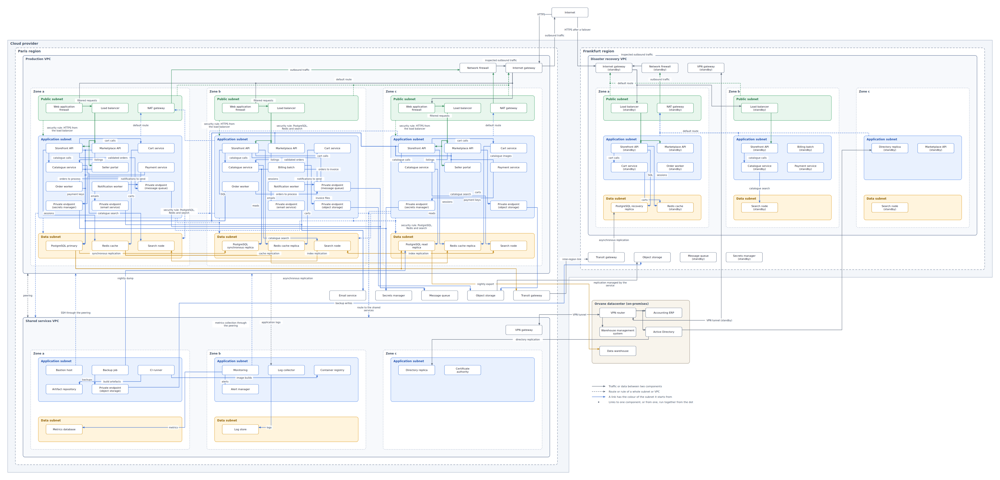

# The diagram test

One document, several formats, the same questions: this repository measures which formats a coding
agent reads right, and what each one costs.

It is the material of a workshop of the Adopt'AI training on agentic development. A group puts the
questions to Claude Code on the picture of a diagram, then on its SVG and on its Mermaid text, and
compares the answers. A benchmark runs the same test on every file, several times per model, and
writes its table in [`benchmark/results.md`](benchmark/results.md).

*`sources/2_deployment/topology.png`: the deployment as a picture. The same folder holds it as an SVG
and as Mermaid text.*

## Contents

| Folder | Contents |
| --- | --- |
| `sources/` | Three subfolders, each one document in several formats |
| `questions/` | Two files per subfolder of `sources/`: the prompt sent for each of its files, where `<file>` stands for the file's name, and the JSON schema its answers must fit |
| `answers/` | One file per subfolder of `sources/`: the expected answers, each with its reason |
| `benchmark/` | The scripts that run the trials, score their answers and write the table; one record per trial in `results/`; the table, `results.md` |
| `build/` | The scripts that build the files of `sources/` |

Everything is in English, except the specification under test, a French document.

## The documents

The three documents describe the same online shop.

| Subfolder | Document | Formats |
| --- | --- | --- |
| `1_data_model/` | Its data model | Mermaid (`.mmd`), SVG, PNG |
| `2_deployment/` | Its deployment at a cloud provider | Mermaid (`.mmd`), SVG, PNG |
| `3_specification/` | The specification of its returns and refunds | Markdown, HTML, a good and a bad Word file, a good and a bad PDF |

- A PNG is a screenshot of its SVG. Both show the same drawing: the SVG keeps its labels as text,
  the PNG holds pixels only.
- In `2_deployment/`, `topology.svg` and its PNG are the drawing laid out for people, the way an
  architect draws it. `topology.mermaid.svg` is the drawing Mermaid makes of the `.mmd`. It is there
  to compare the two drawings, and the benchmark leaves it out.
- The good Word file is the one pandoc writes from the Markdown. The bad one holds the same facts,
  laid out the way a document passed from hand to hand ends up: headings without a heading style,
  every table pasted as screenshots, the footnotes typed by hand far from their numbers, the
  amendment as the scan of its signed page.
- The PDFs are the Word files exported by Word. No script builds them.

## Ask the questions yourself

The agent must find one file and nothing else. At the root of this repository it would find the
expected answers and the other formats of the document. Give it a folder that holds the file only,
at the path the questions name:

    trial=$(mktemp -d)
    mkdir -p "$trial/sources/2_deployment"
    cp sources/2_deployment/topology.png "$trial/sources/2_deployment/"
    prompt=$(sed 's/<file>/topology.png/' questions/2_deployment.md)
    (cd "$trial" && claude "$prompt")

Then compare what it answers with `answers/2_deployment.json`, and start again with `topology.svg`
and `topology.mmd`.

## Run the benchmark

It needs Linux, with `python3`, `claude` and `unshare` on the PATH:

    python3 benchmark/run.py

It writes one JSON file per trial in `benchmark/results/`, then the table `benchmark/results.md`.
Run again, it redoes only the trials in error, then writes the table again. A trial whose file is
deleted is run again too. Each trial is a real session, billed like any other.

### Trials

- The benchmark runs on two models, Haiku and Sonnet, both at low effort.
- A case is one file of `sources/`, except `topology.mermaid.svg`. Each case runs five trials per
  model, ten trials at a time.
- A trial is one `claude -p` call, in a working folder that holds its file only. It runs in safe
  mode, without the machine's own CLAUDE.md, plugins, MCP servers, skills and hooks. A call that
  takes more than five minutes is recorded as an error.
- Each trial is shut in its own mount namespace (`unshare`, Linux only): it finds `/tmp`, `/var/tmp`
  and `/dev/shm` empty and keeps them to itself, and it finds this repository empty. Trials name
  their working files alike: in a shared `/tmp`, one read what another had extracted from another
  format.
- A trial's record keeps its tool calls, in order: they explain an answer.

### Scoring

- A trial answers as one JSON object, which its session checks against the schema of `questions/`
  (`--json-schema`).
- A script scores each answer against `answers/`, with no model in between. It compares names
  without their case or their spacing, and a list as a set unless the expected answer says its order
  counts. A partly right answer is wrong, and so is every answer of a trial that declines to answer.
  An expected answer that changes re-scores the stored trials at the next table.
- A trial succeeds when it answers every question right, whatever it costs.

### Costs

- A control case, a prompt that only replies "ok", gives for each model the cost of an empty session
  that answers through a schema, which is subtracted from every trial of that model.
- Before the trials, one discarded session per model and schema writes its prompt cache. Without it,
  the first sessions of a schema pay for that write: the control case and a folder's first trials
  would cost several times the others.
- The relative cost is a file's cost as a percentage of the one of its subfolder's text format:
  `order_model.mmd`, `topology.mmd` or `spec.md`.

### The table

The table has one section per model, and in it one row per file: its success, the number of trials
that answered every question right, then its relative cost, then for each question the number of
trials that answered it right, the mean cost of the trials and their mean number of turns. The files
whose trials succeed most often come first, and among equals the cheapest first.

## Rebuild the sources

`order_model.mmd`, `build/topology.yaml` and `spec.md` are the sources of the diagrams and of the
specification's HTML page and Word files. The deployment model gives both its Mermaid text
(`build/topology.py`) and the architect's drawing (`build/architecture.py`), which the build stops
on if two links ever have to share a lane.

[mise](https://mise.jdx.dev) installs the tools of the build: Python, uv, Mermaid's CLI, pandoc and
a headless Chrome.

    mise install
    mise exec -- uv run build/build.py
    mise exec -- uv run build/degrade_docx.py

`build.py` builds the diagrams, the HTML page and the good Word file: the same sources give the same
files, byte for byte. `degrade_docx.py` builds the bad Word file.
